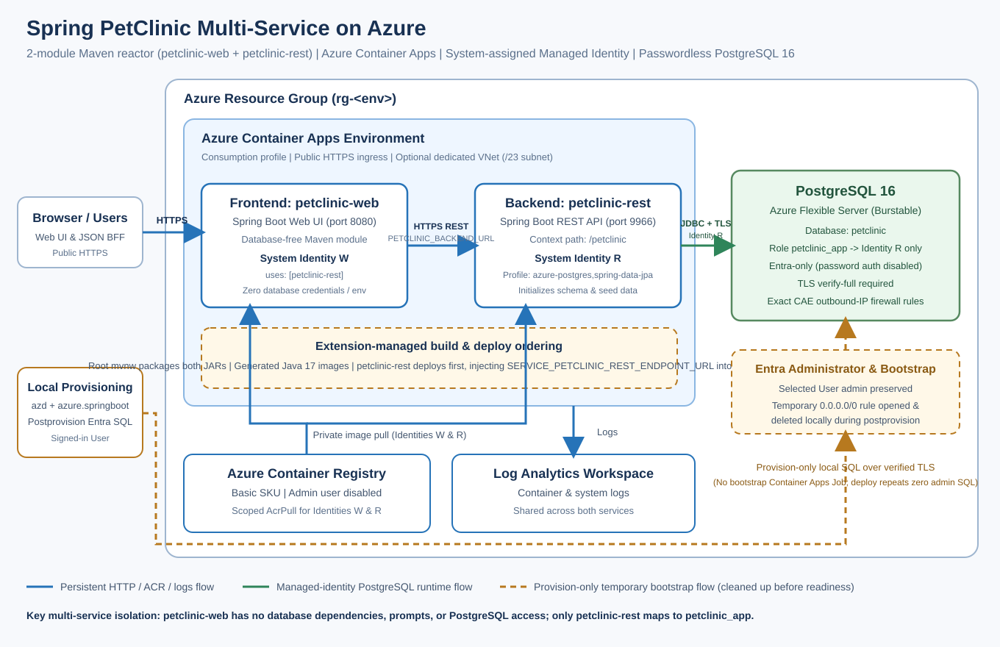

# Spring PetClinic Multi-Service on Azure (Baseline without Extension)

A multi-module Maven `azd` template deploying two Spring Boot services to Azure
Container Apps in one shared environment:

1. **`petclinic-rest`** (`./petclinic-rest`): Spring PetClinic REST API backed by
   Azure Database for PostgreSQL 16 with system-assigned managed identity and
   Entra-only authentication (no database passwords or Key Vault).
2. **`petclinic-web`** (`./petclinic-web`): Database-free Spring Boot Thymeleaf
   UI portal that connects to `petclinic-rest` via `PETCLINIC_BACKEND_URL`
   (`SERVICE_PETCLINIC_REST_ENDPOINT_URL`).

**Demo only:** both endpoints are public and unauthenticated. Do not store
sensitive data.

## Architecture


## Baseline Authoring (Without `azure.springboot`)

In this baseline commit, the template uses built-in `host: containerapp` and
explicitly owns:
- Per-module `Dockerfile`s (`petclinic-rest/Dockerfile` and
  `petclinic-web/Dockerfile`) with `docker:` build blocks in `azure.yaml`.
- PowerShell database lifecycle hooks (`scripts/Prepare-Database.ps1` and
  `scripts/Configure-Database.ps1`) wired to `preup`, `preprovision`, and
  `postprovision`.
- `uses: [petclinic-rest]` on `petclinic-web` so `petclinic-rest` deploys and
  emits `SERVICE_PETCLINIC_REST_ENDPOINT_URL` before `petclinic-web` deploys.

## Deploy

Prerequisites: Azure Developer CLI (`azd`), Azure CLI (`az` signed in to the
same subscription), PowerShell (`pwsh`), JDK 17+, and a running Docker daemon.

```sh
az login
azd auth login
azd up
```

For subscriptions requiring VNet integration on Azure Container Apps:

```sh
azd env set AZURE_USE_VNET true
azd up
```
